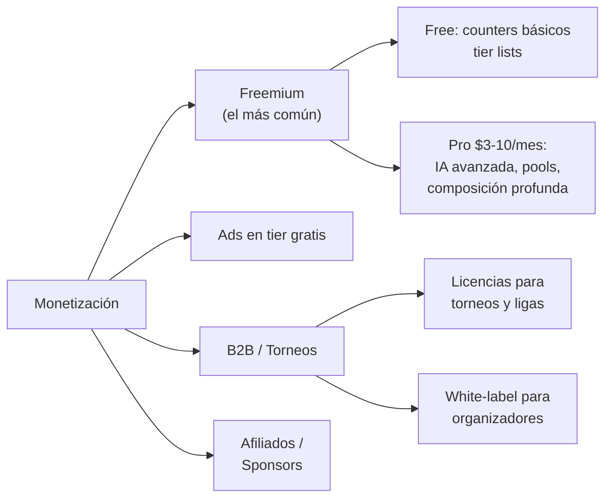

# 🎮 Análisis de Mercado: Herramientas de Draft para LoL

## ¿Ya existe? Sí, y hay varias

El mercado de "draft helpers" para League of Legends **ya está establecido**, pero no está saturado — hay espacio para diferenciarse. Estas son las principales herramientas que existen hoy:

---

## 🏆 Competidores Principales

| Herramienta | Tipo | Modelo de Negocio | ¿Qué hace? |
|---|---|---|---|
| **iTero.gg** | Overlay (Overwolf) | Freemium (\$5-8/mes Pro) | El más popular. Sugiere picks en tiempo real, sinergias, counters, importa runas |
| **ProComps.gg** | Overlay (Overwolf) | Freemium | Top 5 picks por lane, analiza balance AP/AD, frontline, champion pool personal |
| **Smartpick.gg** | Web + Overlay | Freemium | IA que analiza los 10 picks para evaluar sinergias y counters |
| **LoLDraftAI** | Web | Freemium | Red neuronal entrenada con millones de partidas, analiza composición completa |
| **DraftGap** | Web + App | Freemium | Análisis de composición, bueno para Clash y competitivo |
| **Drafter.lol** | Web | Freemium + B2B | Simulador de drafts para torneos y práctica (Fearless Draft) |
| **Scout Ahead** | Web | Freemium + B2B | Enfocado en equipos competitivos y coaches |

---

## 📊 ¿Están bien hechas?

### ✅ Lo que hacen bien
- **iTero y ProComps** tienen buena UX y se integran directo en el cliente via Overwolf
- **LoLDraftAI y Smartpick** usan modelos de IA reales (no solo tablas de counters)
- Varios ofrecen integración con tu champion pool personal

### ❌ Oportunidades / Debilidades comunes
- **Muchas solo muestran datos crudos** sin explicar *por qué* un pick es bueno (falta contexto educativo)
- **Pocas consideran tu elo/rango** de forma inteligente (lo que funciona en Challenger no funciona en Plata)
- **El análisis por fase del juego es raro** (early/mid/late game win conditions)
- **Casi ninguna integra voz/streaming** o se conecta con Discord para equipos
- **Pocas soportan bien LATAM/español** — la mayoría está solo en inglés
- **La experiencia mobile es mala o inexistente** — no hay buenas apps de draft para el celular

---

## 💰 Modelos de Monetización del Mercado



### Rango de precios típico: **\$3 a \$10 USD/mes** (con descuento anual)

---

## 🚀 ¿Qué tipo de app sería más fácil de hacer Y monetizar?

### Recomendación: **Web App con modelo Freemium**

| Criterio | Web App | Overlay (Overwolf) | App Desktop | Mobile |
|---|---|---|---|---|
| **Facilidad de desarrollo** | ⭐⭐⭐⭐⭐ | ⭐⭐ | ⭐⭐⭐ | ⭐⭐⭐ |
| **Costo inicial** | Bajo | Medio-Alto | Medio | Medio |
| **Distribución** | Instantánea (URL) | Depende de Overwolf | Descargas | App stores |
| **Monetización** | Fácil (Stripe, ads) | Vía Overwolf | Complejo | App store fees |
| **Mantenimiento** | Simple | Complejo | Medio | Medio |
| **Alcance** | Todo el mundo | Solo PC | Solo PC | Amplio |

### El stack más práctico sería:

```
Frontend: React/Next.js (rápido, SEO amigable)
Backend:  Python (FastAPI) o Node.js
Datos:    API de Riot Games + scraping de u.gg/op.gg
Base:     PostgreSQL o MongoDB
Hosting:  Vercel (frontend) + Railway/Render (backend)
Pagos:    Stripe
```

---

## 🎯 Nichos donde podrías diferenciarte

> [!TIP]
> El mercado existe pero tiene huecos claros. Acá es donde podrías ganar:

1. **🌎 Enfoque en LATAM/Español** — Casi todo está en inglés. Una herramienta en español con datos específicos del servidor LAS/LAN tendría poca competencia directa
2. **📱 Mobile-first** — No hay una buena app mobile de draft helper. Los jugadores usan el celu mientras esperan la partida
3. **🎓 Draft educativo** — En vez de solo decir "pickea X", explicar *por qué* (ej: "Malphite es bueno acá porque el enemigo tiene 3 AD y tu equipo necesita engage")
4. **🤖 IA conversacional** — Un chatbot/asistente que te diga qué pickear como si fuera un coach hablándote
5. **📊 Por elo/rango** — Recomendaciones que cambien según tu rango (en Plata el macro importa menos que la mecánica individual)

---

## ⚠️ Cosas a tener en cuenta

> [!WARNING]
> - **Riot Games tiene políticas estrictas** sobre apps de terceros. Cualquier herramienta que lea la memoria del cliente o inyecte overlays no autorizados puede resultar en bans. Las apps de Overwolf son "aprobadas" por Riot.
> - **Los datos de la API de Riot son gratis pero con rate limits**. Para escalar necesitás cachear agresivamente.
> - **Actualizar cada patch** (cada ~2 semanas) es obligatorio o la herramienta pierde relevancia.

---

## Próximos pasos sugeridos

1. **Elegí tu nicho** — ¿LATAM? ¿Mobile? ¿Educativo? ¿Alguna combinación?
2. **Validá la idea** — Posteá en Reddit (r/leagueoflegends, r/summonerschool) preguntando qué les falta a las herramientas actuales
3. **MVP rápido** — Empezá con una web app simple que haga UNA cosa bien
4. **Iterá con feedback** — Conseguí 50-100 usuarios beta antes de pensar en monetización
