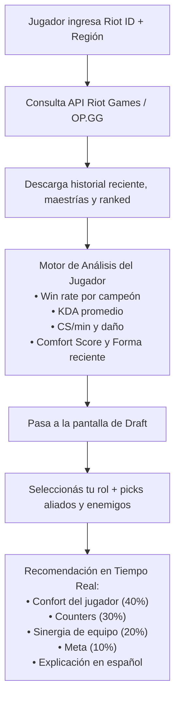

# 🎮 LoL Draft Analyzer — Guía de Uso

Ya tenés armada la aplicación completa y corriendo en tu computadora.

---

## 📍 Ubicación del Proyecto

```
C:\Users\felif\.gemini\antigravity\scratch\lol-draft-analyzer\
```

---

## ⚡ ¿Cómo funciona la aplicación?



---

## 🔑 Configurar tu API Key de Riot Games

Para que la app pueda leer los datos de tu cuenta (igual que OP.GG):

1. Entrá a [Riot Developer Portal](https://developer.riotgames.com/) e iniciá sesión con tu cuenta de LoL.
2. En el Dashboard vas a ver tu **Development API Key** (empieza con `RGAPI-...`). Copiala.
3. Creá un archivo llamado `.env` en la carpeta del proyecto (`lol-draft-analyzer/`) con este contenido:
   ```env
   RIOT_API_KEY=RGAPI-tu-clave-aqui
   ```
*(Las development keys de Riot son gratuitas e instantáneas, duran 24 horas y se renuevan con un click).*

---

## 🚀 Cómo iniciar la app

- **Opción rápida:** Hacé doble click en el archivo `iniciar.bat` que está en la carpeta del proyecto.
- **Opción manual (terminal):**
  ```powershell
  cd C:\Users\felif\.gemini\antigravity\scratch\lol-draft-analyzer
  python run.py
  ```
- **Link en el navegador:** [http://127.0.0.1:8080](http://127.0.0.1:8080)

---

## 💡 Próximos pasos para monetizar / expandir

1. **Scraping directo de OP.GG / U.GG:** Como alternativa o complemento a la API de Riot para no depender de claves que expiren cada 24hs.
2. **Overlay transparente:** Usar Electron / PyQt para que la ventana flote encima del cliente de LoL durante el champ select.
3. **Detección automática de sala:** Leer el cliente de LoL localmente vía LCU (League Client Update API en el puerto local del juego) para no tener que tipear los picks manualmente.
